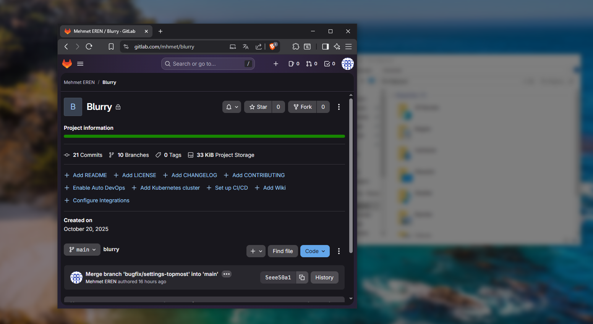
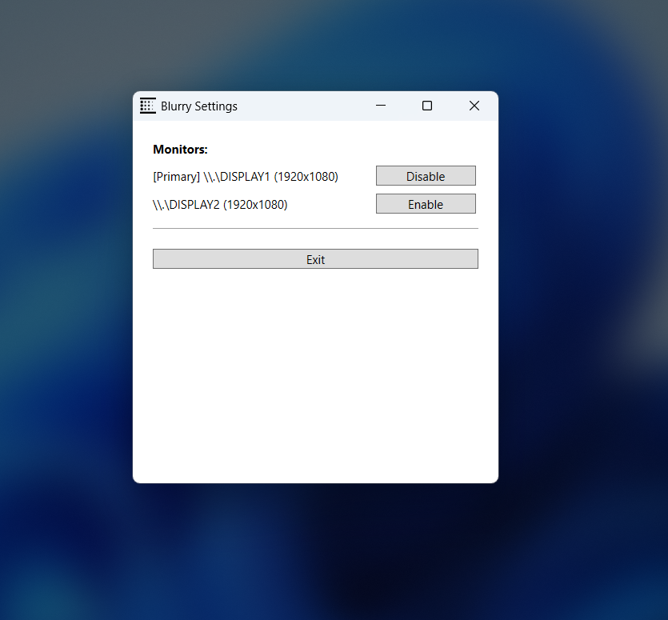

# Blurry – Windows Screen Blur Tool

Blurry is a simple Windows tool that blurs everything on your screen **except the active application window**.  
It is designed to improve privacy, focus, and presentation during meetings or screen sharing.

---

## Features

- **Blur everything except the selected window**  
  Automatically tracks the active window and applies a smooth blur to everything else.

- **Multi-monitor support**  
  Works with single or multiple monitors.  
  Includes a settings window to manage blur behavior for each monitor.

- **Keyboard shortcuts & Tray Icon**
  - **Alt + X** → Toggle blur on the primary monitor  
  - **Ctrl + Alt + X** → Toggle blur on all monitors (close via tray menu)
  - **Tray icon** → Click to toggle blur on the primary monitor or access settings

- **Windows API based**
  Uses low-level Windows APIs to listen for window focus changes and system events.

---

## Screenshots (Slider-Style Preview)

  
  

---

## Installation

1. Download the latest release from the **Releases** page. 
2. Extract the ZIP file. 
3. Run the executable inside the extracted folder. 
4. Use the keyboard shortcuts or the tray icon to toggle blur anytime.

---

## Previous GitLab Project

This project was originally hosted on GitLab.  
Old (archived) GitLab repository: https://gitlab.com/mhmet/blurry

---

## Contributing

Issues and pull requests are welcome.  
Feel free to suggest improvements or report bugs.
